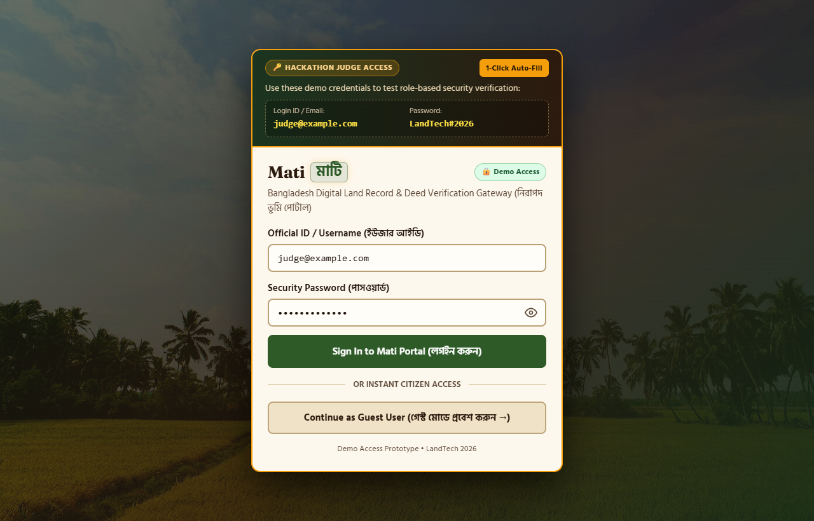
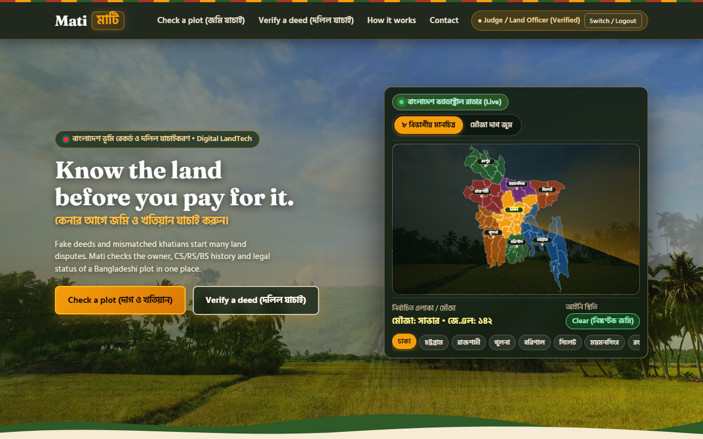
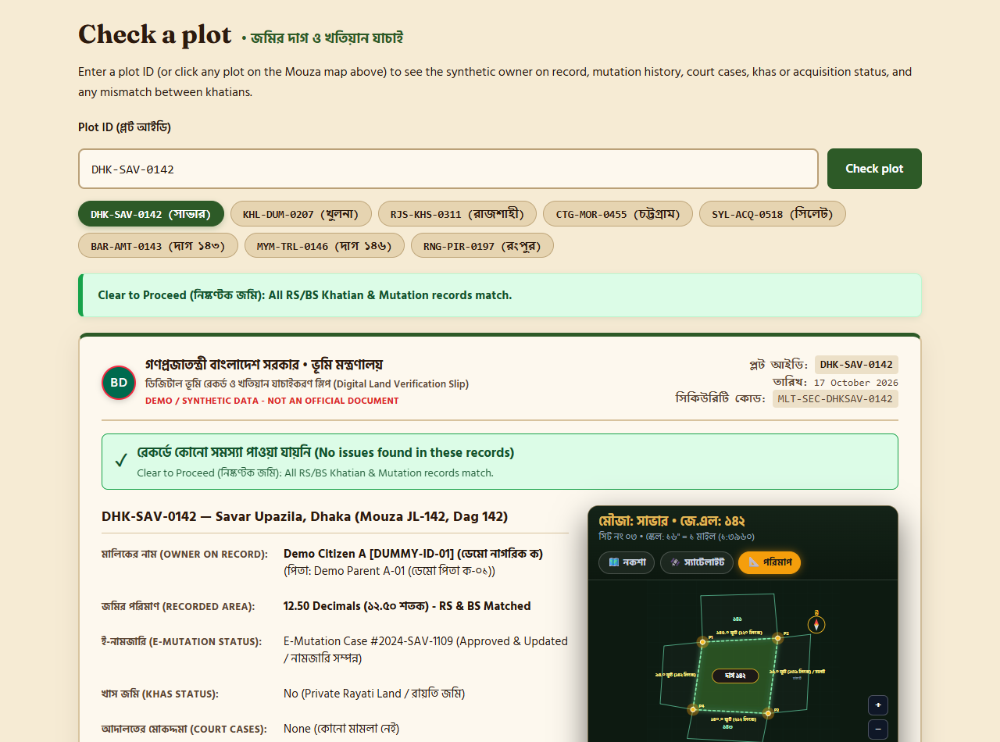
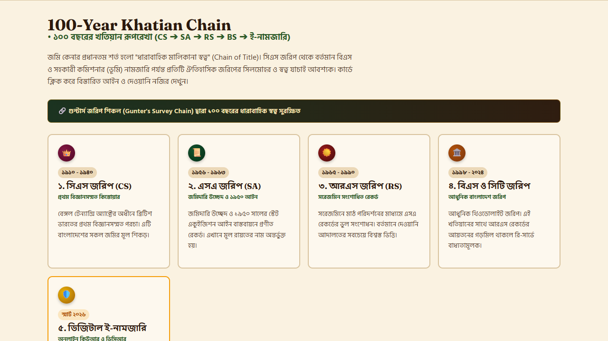
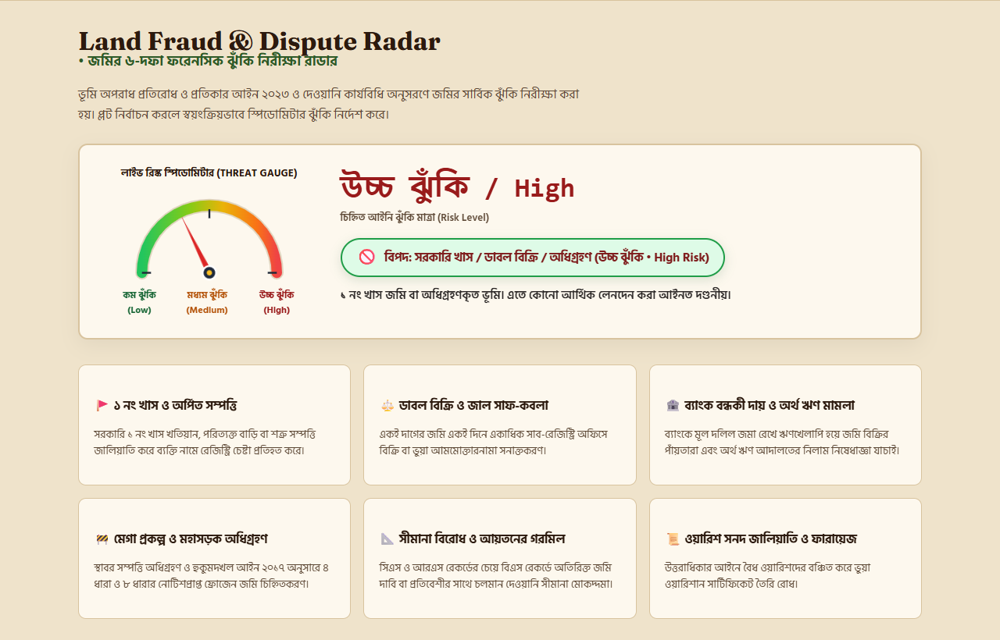
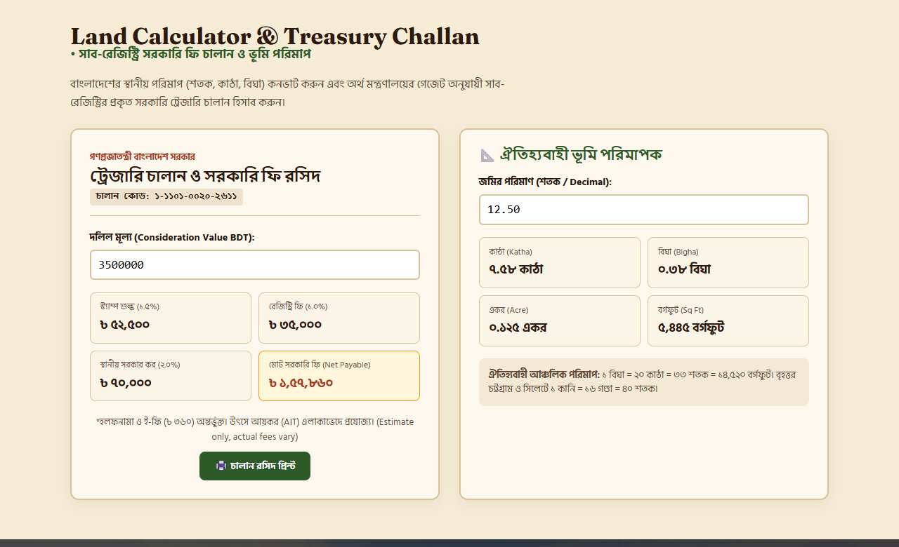
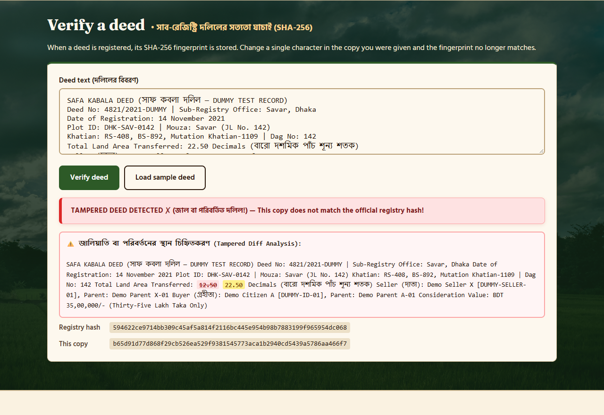

# Mati (মাটি) — Bangladesh Digital Land Record & Deed Verification Gateway

> **কেনার আগে জমি ও খতিয়ান যাচাই করুন (Check before you buy)**  
> An innovative single-file web prototype engineered for the **LandTech Innovation Hackathon 2026**, Daffodil International University.

[](https://nahidzaman1996271-sketch.github.io/mati-landtech-2026/)
[](https://diu.edu.bd)
[](LICENSE)
[](https://developer.mozilla.org/en-US/docs/Web/API/SubtleCrypto/digest)

---

## 📌 Project Overview

- **Track:** Digital Land Records, Verification & Digitization
- **Problem Statements Addressed:**
  - **P5 (Check Before You Buy):** Land Porcha dossier, 100-year continuous title chain, Land Fraud Radar under the *Land Crime Prevention and Redress Act 2023*, Sub-Registry Treasury Challan calculator.
  - **P2 (Verify Deeds & Ownership):** Cryptographic SHA-256 deed ledger verification and word-level LCS tamper diff.
- **Team:** **Team Mati**  
  - **Nahid Ibn Zaman** (Team Leader)
  - **Md. Rasel Hasan Sabuj**
- **Mentors:** Rubayed All Islam (Faculty), Md Jannatul Nayem (Industry)
- **Live Prototype:** [https://nahidzaman1996271-sketch.github.io/mati-landtech-2026/](https://nahidzaman1996271-sketch.github.io/mati-landtech-2026/)

> [!NOTE]
> **Data & Rule Compliance:** All data in this repository is 100% synthetic dummy data created strictly for hackathon demonstration. All owner identities use non-human synthetic tokens (e.g. `Demo Citizen A [DUMMY-ID-01]`, `Demo Seller X [DUMMY-SELLER-01]`) per Rulebook Section 10. No real citizen data, NID, or government databases were accessed.

---

## 📸 Visual Tour & Core Features

### 1. Demo Security Access Gate (with Show/Hide Password Toggle)
A secure entry point with dedicated Hackathon Judge Credentials, 1-Click Auto-Fill (`judge@example.com` / `LandTech#2026`), instant Guest Citizen access, and an accessible inline SVG show/hide password toggle with automatic session state reset.



---

### 2. High-Impact Hero & Interactive 8-Division BS Mouza Map
A 3-second cross-fading landscape slider capturing Bangladesh's rural agricultural heritage, synchronized with an interactive SVG cadastral map covering all 8 administrative divisions (Dhaka, Chattogram, Rajshahi, Khulna, Barishal, Sylhet, Mymensingh, Rangpur).



---

### 3. Plot Check & Authentic Porcha Dossier (P5)
Presents an authentic Bangladeshi Land Porcha (*খতিয়ান ও পরচা স্বত্ব বিবরণী*) complete with an official 50 Taka Court Fee stamp, e-mutation tracking, survey lineage, Bengali audio readout (Web Speech API + offline MP3 audio), and an SMS fallback pill (`16xxx (demo)`).



---

### 4. 100-Year Continuous Khatian Chain
Traces the unbroken chain of title from the colonial era to modern smart governance:
$$\text{CS (1888–1940)} \longrightarrow \text{SA (1956–1963)} \longrightarrow \text{RS (1965–1990)} \longrightarrow \text{BS / City Survey (1998–2024)} \longrightarrow \text{Smart E-Mutation (2026)}$$
Connected through Gunter's survey chain (*গুন্টার্স জরিপ শিকল*) with an interactive educational archival modal.



---

### 5. Land Fraud & Dispute Radar (Risk Speedometer Gauge)
A 6-dimension risk analysis model based on the *Land Crime Prevention and Redress Act 2023*. Features an animated speedometer gauge needle displaying **কম ঝুঁকি (Low)**, **মাঝারি ঝুঁকি (Medium)**, or **উচ্চ ঝুঁকি (High)** risk levels across Khas land, double-selling fraud, bank liens, and acquisition freezes.



---

### 6. Sub-Registry Treasury Challan Calculator & Unit Converter
- **Official Treasury Challan Calculator:** Calculates Stamp Duty (1.5%), Registration Fee (1.0%), Local Govt Tax (2.0%), and Halafnama fees with official treasury code `১-১১০১-০০২০-২৬১১` to protect buyers from broker extortion (*দালাল চক্র*).
- **Traditional Unit Converter:** Live conversion between শতক (Decimal), কাঠা (Katha), বিঘা (Bigha), একর (Acre), and বর্গফুট (Sq Ft).



---

### 7. Non-Circular Cryptographic SHA-256 Deed Verification (P2)
Extracts the deed number, queries a sealed external registry ledger (`REGISTRY_LEDGER`), computes the normalized SHA-256 cryptographic digest via the browser's native Web Crypto API, and visualizes alterations with a word-level Longest Common Subsequence (LCS) tamper diff.



---

## 🧪 100% Synthetic Demo Plot Records

| Plot ID | Division & Location | Legal / Survey Status Demonstrated | Verdict |
|---|---|---|---|
| `DHK-SAV-0142` | Savar, Dhaka | Clean plot, RS & BS records matched, e-mutation verified | 🟢 Clear to Proceed |
| `KHL-DUM-0207` | Dumuria, Khulna | Area discrepancy (RS 14 vs BS 18 dec) + active boundary suit | 🟡 Caution / Warning |
| `RJS-KHS-0311` | Paba, Rajshahi | Government Khas land (খতিয়ান নং ১) — Private transfer illegal | 🔴 Critical Hazard |
| `CTG-MOR-0455` | Sitakunda, Chattogram | Active bank mortgage lien + Artha Rin Adalat court case | 🔴 Critical Hazard |
| `SYL-ACQ-0518` | Dakshin Surma, Sylhet | Compulsory Highway Acquisition freeze (LA Notice Section 4) | 🔴 Critical Hazard |
| `BAR-AMT-0143` | Amtali, Barishal | Rayati land, clean CS/SA/RS/BS lineage, holding tax paid | 🟢 Clear to Proceed |
| `MYM-TRL-0146` | Trishal, Mymensingh | Double-selling alert (two conflicting registered deeds) | 🔴 Critical Hazard |
| `RNG-PIR-0197` | Pirganj, Rangpur | Unsettled succession title (Waris Sanad forgery risk) | 🟡 Caution / Warning |

---

## 🤖 Collaborative AI Engineering Journey

As required by the LandTech 2026 Rulebook, we transparently detail the roles of the AI tools utilized:

```
                      ┌────────────────────────────────────────┐
                      │           Human Developers             │
                      │  Nahid Ibn Zaman & Md. Rasel Sabuj     │
                      └──────────────────┬─────────────────────┘
                                         │
         ┌───────────────────────────────┼───────────────────────────────┐
         ▼                               ▼                               ▼
┌──────────────────┐           ┌──────────────────┐           ┌──────────────────┐
│ Claude Anthropic │           │  Google Gemini   │           │ Google DeepMind  │
│                  │           │   & Argon UI     │           │   Antigravity    │
├──────────────────┤           ├──────────────────┤           ├──────────────────┤
│ • Problem scope  │           │ • Bengali visual │           │ • Non-circular   │
│   (P5 & P2 sync) │           │   palette system │           │   registry ledger│
│ • Initial schema │           │ • Mobile-first   │           │ • Word LCS diff  │
│   & concept note │           │   hero fader     │           │ • Strict XSS esc │
│ • Early deed     │           │ • Responsive     │           │ • Password eye   │
│   hashing logic  │           │   cadastral map  │           │ • Automated tests│
└──────────────────┘           └──────────────────┘           └──────────────────┘
```

### 1. Claude (Anthropic)
- **Concept Formulation & Scoping:** Formulated the unified architecture combining Problem P5 (*Check Before You Buy*) with Problem P2 (*Deed Hashing*).
- **Core Verification Logic:** Authored the initial single-file skeleton, the 5-point plot data structure, and the pitch deck narrative.

### 2. Google Gemini & Argon
- **Cultural Design System:** Created the aesthetic visual redesign incorporating traditional Bangladeshi terracotta (`#a83820`), paddy green (`#2d5a27`), golden mustard (`#f59e0b`), and rich earth tones.
- **Fluid Layout & Map Architecture:** Engineered the 3-second landscape cross-fade slider and responsive interactive SVG map layout for cross-device mobile support.

### 3. Google DeepMind Antigravity
- **Non-Circular Cryptographic Ledger:** Replaced circular self-hashing with an external sealed registry ledger (`REGISTRY_LEDGER`), standardizing normalization across browser and Node environments.
- **Word-Level LCS Tamper Diff:** Built a matrix-based Longest Common Subsequence (LCS) comparison preserving whitespace and token boundaries to highlight edited numbers without false cascades.
- **Defensive XSS Hardening:** Created a centralized `esc()` sanitizer across all dynamic HTML insertion points (`renderWordDiff`, `plotOut`, `openArchivalModal`, `cadastralStudioHtml`).
- **Accessible Show/Hide Password Toggle:** Integrated a mobile-friendly 40x40px inline SVG eye button with full ARIA accessibility (`aria-controls`, `aria-pressed`, `aria-label`), keyboard `:focus-visible` ring, cursor preservation (`selectionStart`/`selectionEnd`), and automatic logout reset.
- **Compliance & Neutrality:** Systematically eliminated real-looking government identifiers, replaced hotline references with `১৬xxx (ডেমো)`, updated judge credentials to `judge@example.com`, and introduced clear synthetic data disclaimers.

---

## 🛠️ How to Run Locally

No external libraries, build steps, or package managers are required.

### Quick Start:
```bash
# Clone the repository
git clone https://github.com/nahidzaman1996271-sketch/mati-landtech-2026.git

# Enter project directory
cd mati-landtech-2026

# Serve with Python built-in HTTP server
python3 -m http.server 8000
# On Windows: py -m http.server 8000
```
Open [http://localhost:8000](http://localhost:8000) in your modern browser.

### Verify the Sealed Registry Hash in Node:
```bash
node -e "const crypto=require('crypto'),fs=require('fs');const s=fs.readFileSync('index.html','utf8');const i=s.indexOf('const SAMPLE_DEED =');const t=s.slice(s.indexOf('\x60',i)+1,s.indexOf('\x60',s.indexOf('\x60',i)+1)).normalize('NFC').replace(/\r\n/g,'\n').trim();console.log(crypto.createHash('sha256').update(t,'utf8').digest('hex'));"
```
**Expected Output:** `594622ce9714bb309c45af5a814f2116bc445e954b98b7883199f965954dc068`

---

## 📂 Repository File Structure

```
mati-landtech-2026/
├── index.html          # Core single-file application (HTML5, CSS3, Vanilla JS)
├── README.md           # Project documentation and visual showcase
├── style.css           # Fallback styles for error handling
├── 404.html            # Custom offline/not-found page
├── render.yaml         # Cloud hosting deployment specification
├── .nojekyll           # Enforces direct asset serving on GitHub Pages
├── audio/              # Synthesized Bengali audio readouts for all 8 plots
│   ├── BAR-AMT-0143.mp3
│   ├── CTG-MOR-0455.mp3
│   ├── DHK-SAV-0142.mp3
│   ├── KHL-DUM-0207.mp3
│   ├── MYM-TRL-0146.mp3
│   ├── RJS-KHS-0311.mp3
│   ├── RNG-PIR-0197.mp3
│   └── SYL-ACQ-0518.mp3
├── images/             # Compressed Unsplash rice-field landscape backgrounds
│   ├── hero-1.jpg
│   ├── hero-2.jpg
│   └── hero-3.jpg
└── screenshots/        # High-resolution documentation screenshots
    ├── 01_judge_gate.png
    ├── 02_hero_mouza_map.png
    ├── 03_plot_porcha_dossier.png
    ├── 04_100yr_khatian_chain.png
    ├── 05_fraud_threat_radar.png
    ├── 06_treasury_calculator.png
    └── 07_sha256_deed_diff.png
```

---

## 📜 Credits & License

- **Fonts:** [Fraunces](https://fonts.google.com/specimen/Fraunces) & [Hind Siliguri](https://fonts.google.com/specimen/Hind+Siliguri) (Google Fonts, SIL Open Font License).
- **Background Photography:** Kresna Arya, Mohd Nasiruddin Mohd Nasir, and Yosafat Herdian via [Unsplash](https://unsplash.com) (Unsplash Free Use License).
- **License:** Released under the MIT License for educational and hackathon evaluation purposes.